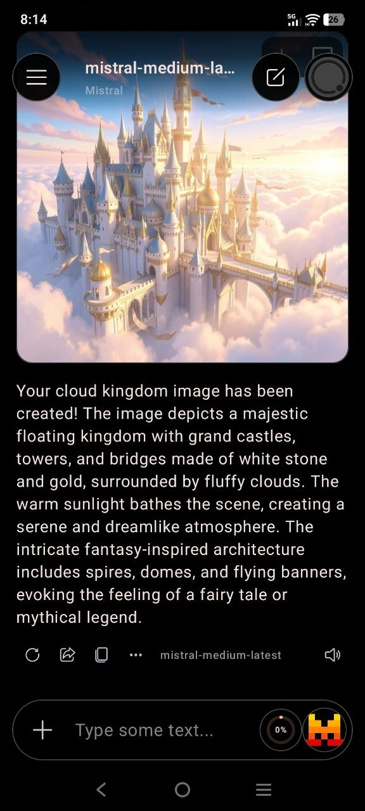
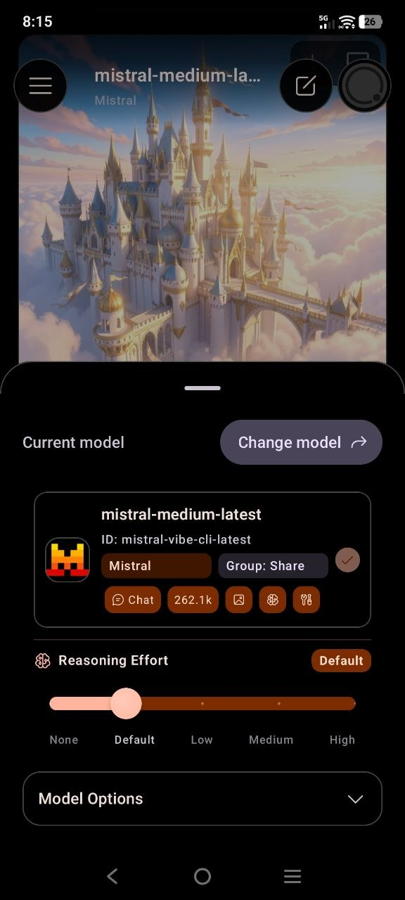
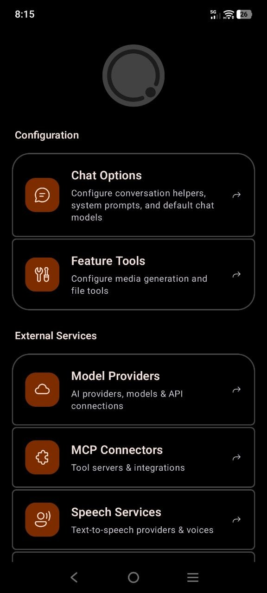

<p align="center">
  
</p>

<h1 align="center">Generative</h1>

<p align="center">
  <strong>Your AI models, tools, and remote machines — together on Android.</strong>
</p>

<p align="center">
  <a href="https://github.com/starfall-org/generative/releases">Download</a> ·
  <a href="https://github.com/starfall-org/generative/issues">Report a problem</a> ·
  <a href="CONTRIBUTING.md">Contribute</a>
</p>

<p align="center">
  
  
  
  
  
  <a href="LICENSE"></a>
</p>

<p align="center" style="white-space: nowrap;">
  
  
  
</p>

Generative is a native Android AI client built for people who want to choose their own models, connect their own tools, and keep their workflow in one place. Bring your own provider or account; Generative does not host models or include API credits.

## Why Generative?

- **Choose your AI.** Use OpenAI-compatible APIs, OpenAI Responses, Anthropic, Google Gemini, Ollama, and supported account-based providers such as ChatGPT Codex, Claude Code, Antigravity, and GitHub Copilot.
- **Make chat do more.** Connect remote MCP servers, select which tools are available, and use supported image or video generation tools.
- **Work beyond the chat.** Connect to remote machines over SSH and use an interactive terminal from your phone.
- **Shape your workflow.** Organize providers, tune model settings, and reuse prompt instructions and profiles.
- **Keep your setup close.** Conversations and app configuration are stored on your device. OAuth credentials are protected with Android Keystore-backed encryption.

Provider features depend on the service, model, and configuration. You may need your own API key or account, and provider usage charges still apply.

## Get started

1. **Install** the latest available APK from [GitHub Releases](https://github.com/starfall-org/generative/releases) on an Android device running Android 8.0 or later.
2. **Add a provider** from the Providers screen. Enter its endpoint and credentials, or use the provider's sign-in flow when available.
3. **Choose a model** and start chatting. Add MCP servers, remote machines, speech services, or media tools when you need them.

Only connect services and MCP servers you trust. Your chosen provider processes the messages you send according to its own policies. Keep API keys and sign-in links private, and prefer HTTPS for remote endpoints.

## Supported integrations

| Integration | What it adds |
| --- | --- |
| AI providers | OpenAI-compatible Chat Completions, OpenAI Responses, Anthropic, Google Gemini, Ollama, and supported account-based providers |
| Tools | Remote MCP over Streamable HTTP or HTTP + SSE |
| Remote access | SSH connections and an interactive terminal |
| Media and speech | Configurable speech services, Android text-to-speech, and supported image/video generation |

Generative is an Android-native app built with Kotlin and Jetpack Compose. It does not currently provide iOS, web, Windows, macOS, or Linux apps.

<details>
<summary>Advanced: add a provider with a link</summary>

Generative can receive a provider link from a browser or another app and open the provider editor with its details prefilled.

```text
generative://provider?name={name}&url={url}&key={key}&auth_type={auth_type}&provider_type={provider_type}&icon_url={icon_url}
```

Example:

```text
generative://provider?name=My%20Gateway&url=https%3A%2F%2Fapi.example.com%2Fv1&key=YOUR_API_KEY&auth_type=platform&provider_type=chat-completions
```

- URL-encode parameter values, especially credentials and URLs.
- `provider_type` defaults to `chat-completions`; supported values include `responses`, `anthropic`, `gemini`, `ollama`, `antigravity`, `github-copilot`, `openai-codex`, and `claude-code`.
- `auth_type` defaults to `platform`; supported values include `none`, `bearer`, `query`, `custom-header`, and `oauth`.
- `icon_url` is optional and must be an HTTP(S) image URL. The legacy `mg://` scheme and the older `type`/`auth` parameter names remain supported.
- Opening a link creates a new provider; it does not overwrite an existing one. Links containing credentials are sensitive.

</details>

## Build from source

Requires JDK 17 and an Android SDK. Configure `sdk.dir` in `local.properties`, then run:

```bash
./gradlew :app:assembleDebug
```

See [CONTRIBUTING.md](CONTRIBUTING.md) for development and testing guidance.

## License

Generative uses the [Starfall Org Contributor Commercial Copyleft License v1.1](LICENSE). The app must remain non-commercial except where the license explicitly allows otherwise. Publishing or distributing it through an app store requires prior written permission from Starfall Org. Read the license for the complete terms.

## AI Tools and Models

This project was developed with the assistance of various AI tools and models.
